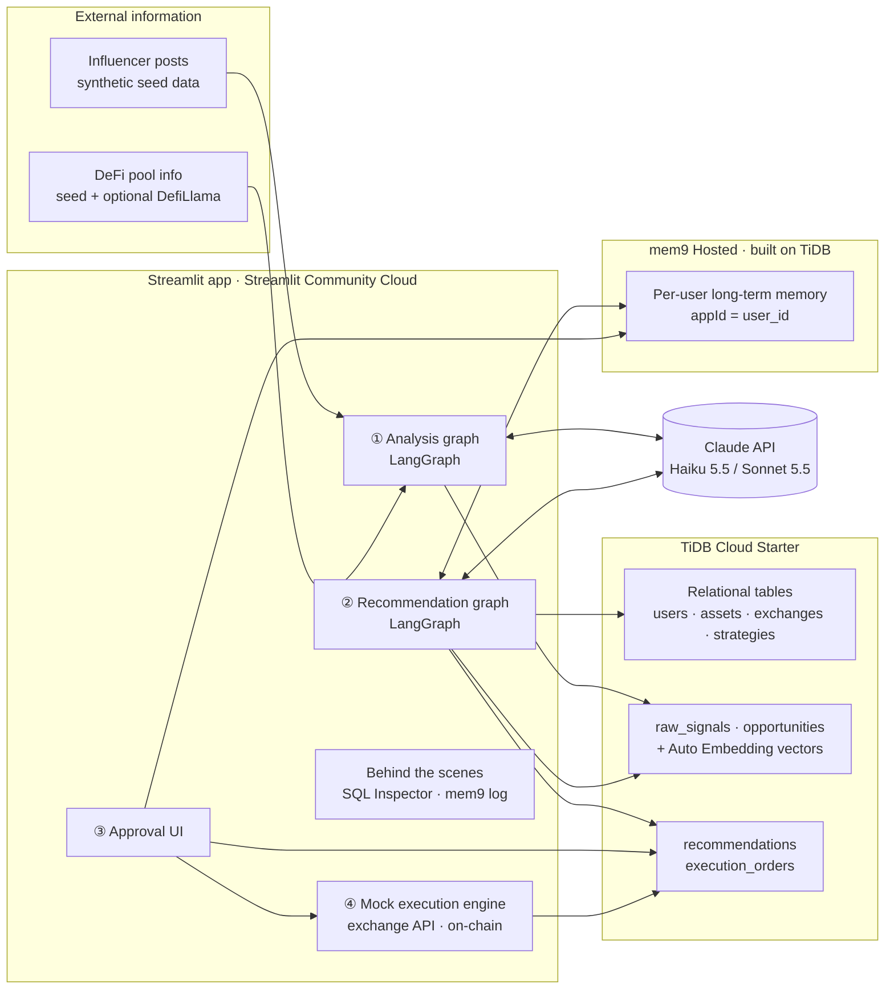
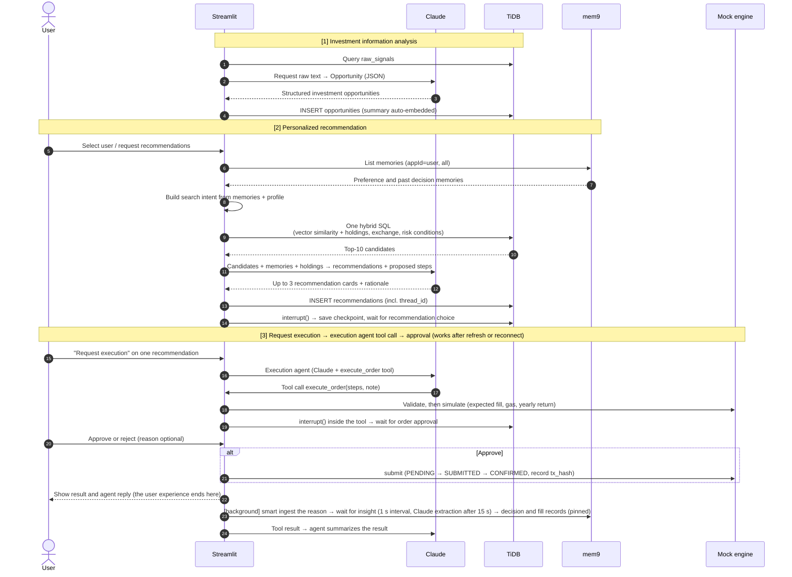
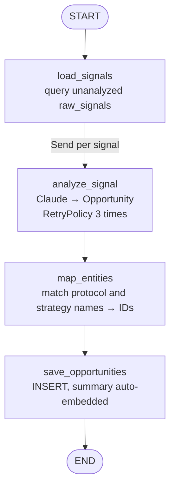
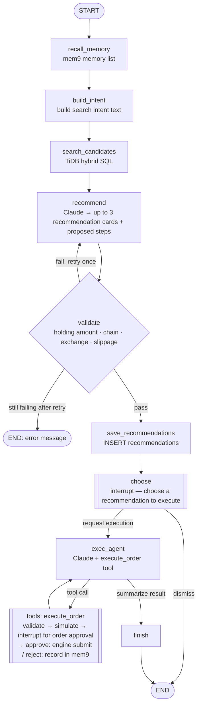

# End-to-End AI Investment Recommendation Demo on TiDB + mem9 — Architecture

> Version 2.0 · 2026-10-29 (Korean/English switch, Google sign-in, access and activity log, deployment prep)
> Status: Final (baseline document for implementation)

---

## 0. Summary

The AI service flow this demo shows is:

1. AI collects and analyzes external influencer and DeFi investment information
2. It recommends investment opportunities that fit each user's holdings and exchange setup
3. After the user approves, the existing automation engine executes

### 0.1 Assumptions behind the demo scenario

- **Assumed service**: A service that links domestic and overseas exchange accounts to show a user's crypto assets in one place is adding AI recommendations and execution.
- **Design principles**
  - **CEX-centric data**: 4 domestic and 4 overseas exchanges, exchange savings and staking products, and XRP and KAIA are included. The default case is assets held in exchange accounts.
  - **An engine that takes both routes**: The same `execute_order` tool accepts orders inside an exchange account (exchange API route) and on-chain orders. Whichever style the engine to integrate uses, it plugs into the same structure.
  - **Overseas account reporting reference scene**: TiDB aggregates month-end balances on overseas exchanges and shows, **as reference information only**, how far they are from the overseas account reporting threshold (month-end total of KRW 500M) on the dashboard and the approval screen. SQL does the calculation, the LLM is not involved, and the app states that the judgment is left to a tax professional.
  - **Human approval**: AI only proposes; execution requires human approval.
- **Regulatory note**: Personalized investment recommendations may be subject to investment advisory regulations depending on the region. Moving to a real service requires legal review, and this document does not make that judgment.

This demo shows the whole flow above end to end in **a single Streamlit app**. The two key messages are:

- **TiDB**: Investment information, user assets, exchange and strategy data, and vector embeddings are handled in **one DB with one SQL**. No separate vector DB or embedding pipeline is needed.
- **mem9**: It **remembers across sessions** a user's past recommendations, preferences, and rejection reasons, and applies them to the next recommendation. mem9 itself runs on TiDB, so **data and memory share the same tech stack**.

| Component | Choice | Cost |
|---|---|---|
| UI | Streamlit → deployed on Streamlit Community Cloud | Free |
| Database | TiDB Cloud Starter (AWS region) | Free tier |
| AI long-term memory | mem9 Hosted (`api.mem9.ai`) | Free to start |
| LLM | Claude API (via LangChain `ChatAnthropic`) — default `claude-haiku-5-5`, optional for demos `claude-sonnet-5-5` | Under $1 for the whole demo with Haiku |
| Workflow | LangGraph — analysis graph + recommendation/approval graph. Recommendation waits for human approval with `interrupt()`; checkpoints are stored in TiDB | Open source |
| Tracing (optional) | LangSmith — inspect prompts, responses, and tokens per node | Free developer tier |
| Execution engine | In-app mock engine (simulates both the exchange API and on-chain routes) | — |

---

## 1. Understanding the technical components (for newcomers)

### 1.1 TiDB Cloud Starter

- **What it is**: The serverless version of PingCAP's distributed SQL database TiDB (formerly TiDB Serverless). It is **MySQL compatible**, so MySQL drivers and SQL work as is.
- **Features used in this demo**
  - Regular relational tables (users, assets, exchanges, strategies, etc.)
  - `VECTOR(n)` type and vector index → similarity search
  - **Auto Embedding**: The DB generates the vector column from a text column automatically. No external embedding API key is needed.
- **How Auto Embedding works**

```sql
-- 1) Table definition: declare the vector column as a "generated column"
CREATE TABLE sample (
  id        INT PRIMARY KEY,
  content   TEXT,
  embedding VECTOR(1024) GENERATED ALWAYS AS (EMBED_TEXT(
              "tidbcloud_free/cohere/embed-multilingual-v3",
              content,
              '{"input_type": "search_document", "input_type@search": "search_query"}'
            )) STORED,
  VECTOR INDEX ((VEC_COSINE_DISTANCE(embedding)))
);

-- 2) On INSERT, the DB fills embedding automatically
INSERT INTO sample (id, content) VALUES (1, 'Stablecoin lending yields rising');

-- 3) Search also queries with "text" directly, not a vector
SELECT id, content
FROM sample
ORDER BY VEC_EMBED_COSINE_DISTANCE(embedding, 'stable interest income')
LIMIT 3;
```

- **Model choice**: Because the content is in Korean, the demo uses **`tidbcloud_free/cohere/embed-multilingual-v3`** (1024 dimensions, 100+ languages, free).
  - Limit: input up to 512 tokens / 2,048 characters → the **summary field** is embedded instead of the long original text.
  - Limit: Auto Embedding is supported **only on Starter instances in AWS regions**.

### 1.2 mem9

- **What it is**: A **long-term memory layer for AI agents** built by PingCAP. It extracts and stores "facts worth remembering" from conversations or events and returns them later.
- **Internals**: A REST server written in Go (`mnemo-server`) that uses **TiDB Cloud Starter** as its storage.
- **This demo uses the Hosted version** (`https://api.mem9.ai`). There is nothing to install or operate, and switching to self-hosting later **only changes the URL and API key**.
- **Core API** (header `X-API-Key: <key>`)

| Purpose | Method / path | Main parameters |
|---|---|---|
| Issue API key | `POST /v1alpha1/mem9s` | None → the `id` in the response is the API key |
| Check key status | `GET /v1alpha2/status` | — |
| Write memory | `POST /v1alpha2/mem9s/memories` | `content` or `messages` (one of the two), `appId`, `memory_type`, `tags`, `metadata`, `mode` (`smart`/`raw`), `sync` |
| List / search memories | `GET /v1alpha2/mem9s/memories` | `appId`, `memory_type` (`insight`/`pinned`/`session`), `tags`, `limit`, `offset`, `q` (response: `memories`, `total`, `limit`, `offset`) |
| Get / update / delete one | `GET/PUT/DELETE /v1alpha2/mem9s/memories/{id}` | — |

- **Two ways to write**
  - `content`: Stores an already-formed fact as is (e.g. "Does not want leveraged products"). Stored with `memory_type: pinned` as a fixed memory.
  - `messages` + `mode: smart`: Pass the conversation and **mem9 uses an LLM to extract facts (`insight`), comparing them with existing memories to resolve duplicates and conflicts**. This is what sets it apart from simple log storage. The original text is also stored as type `session`.
- **Behavior confirmed on the Hosted API** (smoke test on 2026-10-29, reflected in the design)

| Item | Finding | Design response |
|---|---|---|
| `q` search | **Closer to word matching** than semantic search. "risk tolerance" does not find a "volatile products" memory, and in Korean, a word with a particle attached ("변동성이") is not found by "변동성" | Recommendations do not use `q`; they fetch **the user's whole memory list** and pass it to Claude (enough at a scale of a few dozen memories per user) |
| `content` write | `memory_type` **allows only `pinned`** (`insight` returns 400, unlike the API docs) | All memories the app writes directly are `pinned` |
| smart ingest | Processed **asynchronously** (202); `insight` is usually extracted within **3–25 seconds** | After a rejection, wait up to 30 seconds with progress shown on screen |
| smart ingest input format | When a Korean assistant message (the recommendation text) is sent along, **nothing is extracted** (3 of 3 times). Sending **only the user's utterance** gets extracted | Send only the rejection reason (user utterance), and record which product it was in a separate `pinned` decision record |
| Extraction language | Even when the user speaks Korean, `insight` is **stored in English** (e.g. "Rejects investment products with high volatility") | Claude understands the English memory as is, and the screen shows it rephrased in Korean |
| Extraction reliability | Sometimes nothing is extracted even under the same conditions | If there is no `insight` within 15 seconds, Claude extracts the facts and they are stored as `pinned` (fallback path) |
| Decision record order | When the decision record (pinned) containing the reason was stored **first**, extraction failed twice in a row in English mode. Presumably because the decision record and the reason text were nearly the same, mem9 treated it as overlapping an existing memory | Changed the order to reason ingest → wait for extraction → decision record. After the change, extraction happened once in English and once in Korean (the cause is a guess; not yet verified repeatedly) |

- **There is no Python SDK**, so a thin client (`core/mem9_client.py`) was written with `httpx`. It records the request and **response JSON** of every call and shows them on the Behind the scenes screen (list responses show only the first 20).

#### 1.2.1 Compression and summarization in smart ingest, and context loss

The source is the mem9 GitHub design document `docs/architecture/mem9-algorithms` (facts-extraction, reconciliation). The same content is shown in Korean and English in the **Tech notes** tab of ⑤ Behind the scenes.

- **Stage 1, fact extraction (summarization)**: By default only `user` utterances are used as evidence (`system` and `tool` are excluded; `assistant` only when configured). Each fact is a short sentence that makes sense on its own, and the source utterances (`source_seqs`) are kept in metadata. Search intents, temporary states, and task-log types are discarded.
- **Stage 2, reconcile**: For each new fact, existing `insight` and `pinned` memories are found by vector (similarity below 0.3 excluded) and keyword, passed to the LLM once with up to 60 candidates, and it returns `ADD` / `UPDATE` / `DELETE` / `NOOP`.
  - `UPDATE` does not overwrite. In one transaction it marks the old memory `archived` and links it to the new memory with `superseded_by`.
  - `DELETE` does not delete the row; it changes the state to `deleted`.
  - Reconcile does not delete or modify `pinned` (if one is an UPDATE target, a new insight is created separately).
  - If the LLM call or JSON repair fails, all writes in that round are skipped to prevent bad writes.
- **Original text**: The original conversation can be stored as `session`, separately from extraction.

| Possible loss | This demo's response |
|---|---|
| Summarization reduces tone and conditions. The design document says the original language is kept, but on Hosted, Korean reasons are stored as English insights | Store the original reason text verbatim in the decision record (`pinned`) as well |
| Not extracted because it is judged temporary, or due to an LLM error | If there is no insight within 15 seconds, Claude extracts it and it is stored as `pinned` |
| UPDATE and DELETE drop old insights from the active list | Decision and fill records are `pinned`, so reconcile does not touch them. The IDs of memories used as evidence are stored in `recommendations.memory_refs` |
| The list API returns only up to `limit` items | Page with `offset` up to `total` and read them all (`Mem9Client.list_all`) |
| Hundreds of memories make the prompt long | At demo scale, all of them are included. At production scale, mem9 hybrid search picks only relevant memories, and `pinned` is always included |

### 1.3 Claude API (via LangChain)

- Model calls go through **LangChain's `langchain-anthropic` package (`ChatAnthropic`)**. All calls are collected in one file, `core/llm.py`, and the rest of the code only uses that file's functions.
- **Why LangChain**
  - LangGraph's `stream_mode="messages"` gives **token-level streaming** out of the box → recommendation rationale appears on the Streamlit screen in real time.
  - Setting environment variables is enough to trace prompts, responses, and tokens per graph node with **LangSmith**.
  - If you already use the LangChain ecosystem or want to compare with other models, swapping is easy with `init_chat_model`.
- **Structured Output**: Pass a Pydantic model, as in `llm.with_structured_output(Opportunity)`, to get the result as an object. The approach that uses the Claude API's native structured output (the API guarantees schema compliance) (`method="json_schema"`) is preferred, because the format of commands passed to the execution engine must not break.
- **Model**: Default `claude-haiku-5-5` (input $0.10 / output $0.50 per million tokens). To raise quality on demo day, just set `LLM_MODEL=claude-sonnet-5-5` ($2 / $10).
- **Cost-saving settings**: `effort = "low"` reduces internal reasoning, and `cache_control` on the fixed system prompt applies prompt caching.
- **Findings** (smoke test on 2026-10-29, `langchain-anthropic` 1.7.7): Native structured output (not replaced by the tool-calling method), `effort` (passed via `output_config`), prompt caching (cache read confirmed on the 2nd call), and streaming all work. If a feature becomes unsupported later, only that call inside `core/llm.py` will be handled with the official `anthropic` SDK (`client.messages.parse()`). Callers do not change.

```python
# core/llm.py (outline)
from langchain_anthropic import ChatAnthropic

def get_llm(**overrides):
    return ChatAnthropic(model=settings.LLM_MODEL, max_tokens=4096, **overrides)

def structured(schema, **overrides):
    return get_llm(**overrides).with_structured_output(schema, method="json_schema")
```

### 1.4 LangGraph

- **What it is**: An open-source library for defining and running LLM workflows as **graphs made of nodes and edges**. It is built by the LangChain team; in this demo, model calls inside nodes use LangChain `ChatAnthropic` (see 1.3).
- **Two graphs make up the whole flow** (details in 2.4)
  - `analysis_graph`: raw signals → investment opportunities. There is no approval, so it uses no checkpointer.
  - `recommend_graph`: recommendation → approval → execution. It uses a checkpointer.
- **Features used in the analysis graph**
  - **`Send` (parallel branches)**: Runs an analysis node for each signal concurrently and gathers the results. Concurrency is limited with `max_concurrency` to respect API rate limits.
  - **`RetryPolicy`**: Retries automatically at the node level when an LLM call fails.
- **Features used in the recommendation graph**
  - **`interrupt()` (waiting for a human)**: It pauses in two places: when recommendation cards are shown and the user picks one to execute (`choose` node), and when the execution agent calls the engine API tool (`execute_order`) and waits **inside the tool** for order approval. When the user picks, approves, or rejects, `Command(resume=...)` continues **from where it paused**.
  - **Tool calls (`ToolNode`)**: The execution agent (Claude) calls the execution engine API as a tool. Details in 2.4.2.
  - **Checkpoints**: The graph state is saved whenever a node finishes. Because the store is **TiDB**, **pending approvals stay in place** even if the browser is refreshed, the app restarts, or the user connects from another device.
- **Unit of execution**: One recommendation request = one LangGraph **thread** (`thread_id = "rec_<uuid>"`). This ID is stored in `recommendations.thread_id` and used to reload the waiting graph.
- **Checkpointer: a hand-written `TiDBSaver`** (`core/checkpoint_tidb.py`)
  - The smoke test confirmed that the community package `langgraph-checkpoint-mysql` cannot be used with TiDB. `DEFAULT ('{}')` in table creation, `JSON_TABLE` in the core query that reads checkpoints, and `INSERT ... AS new` in the save query are all syntax errors in TiDB.
  - `TiDBSaver` ports the same storage structure as LangGraph's default `InMemorySaver` to three TiDB tables (`lg_checkpoints`, `lg_checkpoint_blobs`, `lg_checkpoint_writes`). It uses only plain `SELECT` and `INSERT ... ON DUPLICATE KEY UPDATE`.
  - It reuses one connection guarded by a lock, and if the connection drops, it reconnects and retries once. All writes are safe to run twice, so retrying is harmless.
  - `lg_checkpoints` has separate `step`, `source`, and `created_at` columns so the Behind the scenes screen can query them directly with SQL.
  - **Measurements** (Tokyo region, round trip about 40 ms): In a two-node graph, 0.55 seconds to reach the approval wait, then 0.47 seconds to continue. A new TLS connection takes 1.3 seconds, so the whole app reuses one connection (`st.cache_resource`).
  - Local unit tests may use `InMemorySaver`. The graph code is the same.

```python
from core import db
from core.checkpoint_tidb import TiDBSaver

checkpointer = TiDBSaver(lambda: db.connect(autocommit=True))
checkpointer.setup()          # first time only: create lg_* tables (leaves them as is if they exist)
graph = builder.compile(checkpointer=checkpointer)
```

---

## 2. Overall architecture

### 2.1 Component diagram



### 2.2 End-to-end processing flow



### 2.3 Where TiDB and mem9 come together

What sets this demo apart is that the two products are **not demonstrated separately; each becomes the other's input**.

1. **Memory → search**: User memories pulled from mem9 ("dislikes volatility", "prefers stablecoins") become the **query text** for TiDB vector search. The same market data yields different candidates per user.
2. **Data → judgment**: TiDB's live holdings and exchange data filter down to "executable" candidates only, and on top of that the LLM ranks and explains them using mem9 memories as evidence.
3. **Decision → memory**: The user's approval or rejection and the reason go back into mem9 and change the next recommendation.
4. **Same stack**: mem9 also runs on TiDB, so operationally the data layer is unified. LangGraph checkpoints are stored in the same TiDB too, so **business data, AI memory, and workflow state are all in one place**.

### 2.4 LangGraph workflows

The whole flow is built consistently with LangGraph, but because they run at different times, it is split into two graphs.

| Graph | When it runs | Checkpointer | Files |
|---|---|---|---|
| `analysis_graph` | ① screen "Run AI analysis" button | None | `core/analyzer.py` (nodes), `core/workflow.py` (graph) |
| `recommend_graph` | ③ screen recommendation request, ④ screen request execution and approve/reject | TiDB | `core/recommender.py` (nodes, tool), `core/workflow.py` (graph) |

#### 2.4.1 Analysis graph (`analysis_graph`)



- `analyze_signal` results accumulate in the state field `opportunities: Annotated[list, operator.add]`, and `map_entities` runs once after all branches finish.
- Example run: `analysis_graph.invoke({"workspace": ws}, {"max_concurrency": 12})` (raising it from 8 to 12 cut analysis of 40 signals from about 16 seconds to 12 seconds, with no 429s)
- Opportunities with low confidence (`confidence`) or no matching protocol are dropped in `map_entities`, and the reason is logged.

#### 2.4.2 Recommendation and approval graph (`recommend_graph`)



**Execution agent and engine tool**

- The execution engine API is **registered as the agent's tool (`execute_order`)**, and **approval is enforced with `interrupt()` inside the tool code**. Whatever the LLM does, it must pass this approval gate to reach the engine.
- Order inside the tool:
  1. Validation: `step_errors`, the same function used for recommendation validation. On failure, the error goes back to the agent, which fixes it and calls again (up to 3 times).
  2. `engine_mock.simulate()`: Computes the expected fill amount, gas, and expected yearly return.
  3. `interrupt()`: Shows the approval screen exactly the arguments the agent passed (order summary `note`, steps, simulation).
  4. Approve → `engine_mock.submit()`; reject → record the reason in mem9.
- **On resume, the tool runs again from the start.** So only side-effect-free validation and simulation come before `interrupt()`. The command ID (`cmd_` + tool call ID) and expiry time (selection time + 30 minutes) are also made to come out the same every time, so the command shown on the approval screen and the command executed stay identical. This is checked every time by scenario pass criterion 7.
- **Parallel tool calls are blocked** (`bind_tools(..., parallel_tool_calls=False)`), so that several approval waits never occur at once.
- **LP order rule**: Two steps, swap → deposit, and both steps must have the same amount (each half of the total). At first the rule was ambiguous, so the steps differed from run to run and the amount on the approval screen was wrong. This was fixed by putting the rule in the prompt and in validation.

**Graph state (`RecommendState`, [core/workflow.py](../core/workflow.py))**

| Field | Filled by node | Content |
|---|---|---|
| `user_id`, `thread_id` | input | Target user, LangGraph thread |
| `profile`, `holdings`, `exchanges`, `memories` | recall_memory | User context and mem9 memories (pinned, insight) |
| `intent`, `intent_reason` | build_intent | Vector search query text and why |
| `candidates` | search_candidates | Top-10 candidates |
| `drafts`, `attempts`, `validation_errors` | recommend / validate | LLM drafts, attempt count, validation errors |
| `cards` | validate / save_recommendations | Recommendation cards (incl. proposed steps `proposed_steps`, `recommendation_id`) |
| `selected`, `selected_at` | choose | Recommendation requested for execution and selection time |
| `messages` | exec_agent / tools | Execution agent conversation (incl. tool calls and results) |
| `outcome`, `command`, `order`, `memory_events` | execute_order tool | approved/rejected/failed, command on the approval screen, fill result, mem9 write log |

**The two points that wait for a human**

| interrupt | Value (`__interrupt__[0].value`) | Resume value |
|---|---|---|
| `choose` node | `{"type": "choose_card", "cards": [...]}` | `{"recommendation_id": ...}` or `{"action": "dismiss"}` |
| `execute_order` tool | `{"type": "order_approval", "title", "note", "command", "simulation"}` | `{"action": "approve"}` or `{"action": "reject", "reason": "..."}` |

- `recommendations.status`: `AWAITING_APPROVAL` → recommendations not chosen become `SKIPPED` → the chosen one becomes `APPROVED` / `REJECTED` (`FAILED` if the execution agent never manages to build an order)

**Streamlit integration**

```python
config = workflow.thread_config(thread_id)
# ③ Recommendation screen: pauses at choose
state = graph.invoke({"user_id": uid, "thread_id": thread_id}, config)
cards = state["__interrupt__"][0].value["cards"]
# ④ "Request execution" → the execution agent calls the tool and pauses at the approval wait inside the tool
state = graph.invoke(Command(resume={"recommendation_id": rid}), config)
approval = state["__interrupt__"][0].value          # note, command, simulation
# ④ Approve/reject buttons
state = graph.invoke(Command(resume={"action": "reject", "reason": reason}), config)
```

**Streaming**: Screen ③ runs `graph.stream(..., stream_mode=["messages", "updates"])`, showing the `recommend` node's rationale token by token and displaying the progress step each time a node finishes (load memories → SQL → recommend → validate).

**Scene to show in the demo**: After getting recommendations, **even if you close and reopen the browser or connect from another device**, the pending approval is still on screen ④, and approving continues execution from where it paused. The Behind the scenes tab shows that thread's checkpoint history (state per node).

---

## 3. TiDB data model

### 3.1 Tables

| Table | Main columns | Role |
|---|---|---|
| `users` | id, name, name_en, risk_profile (`conservative`/`balanced`/`aggressive`), max_risk_level (1–5), base_currency | User profile (Korean and English names) |
| `exchanges` | id, name, type (`CEX`/`DEX`), region (`KR`/`GLOBAL`/`ONCHAIN`) | Exchanges (8 CEX + 3 DEX), domestic vs. overseas |
| `exchange_chains` | exchange_id, chain | Chains an exchange supports |
| `user_exchange_accounts` | user_id, exchange_id, status | Exchanges a user can use |
| `assets` | symbol, chain, category (`stable`/`major`/`alt`) | Token master |
| `user_holdings` | user_id, asset_symbol, chain, amount, usd_value, updated_at | Live holdings |
| `balance_snapshots` | user_id, month_end, exchange_id, asset_symbol, amount, price_usd, krw_value | Month-end balance history on overseas exchanges (overseas account reporting reference) |
| `protocols` | id, name, chain, tvl_usd, audited, risk_score (1–5) | DeFi protocols and exchange savings/staking products (Upbit staking, Binance Simple Earn, Bybit Savings, OKX Earn) |

| `strategies` | id, type (`swap`/`lend`/`stake`/`lp`), action_template (JSON) | Strategy templates the execution engine understands |
| `raw_signals` | id, source, author, content, posted_at | Collected raw text (no embedding: semantic search happens only on `opportunities`, so it was left out to shorten reset time) |
| `workspaces` | id, created_at, reset_at | Per-visitor workspace (hash of the Google account email; the email itself is not stored). Section 6.3 |
| `analyzed_signals` | workspace, signal_id, analyzed_at | Raw signals already analyzed per workspace |
| `opportunities` | id, workspace, signal_id, title, asset, chain, protocol_id, strategy_id, action_type, expected_apy, risk_level, horizon, confidence, summary, rationale, summary_vec (Auto Embedding), status, created_at | Investment opportunities structured by the LLM |
| `recommendations` | id, workspace, user_id, opportunity_id, thread_id, rank, rationale, memory_refs (JSON), command (JSON), model, status (`AWAITING_APPROVAL`/`SKIPPED`/`APPROVED`/`REJECTED`/`FAILED`), decided_at, created_at | Recommendation history, linked to the LangGraph thread |
| `execution_orders` | id, recommendation_id, command (JSON), status (`PENDING`/`SUBMITTED`/`CONFIRMED`/`FAILED`), tx_hash, created_at, updated_at | Execution commands and status |
| `access_logs` | id, at, event, email, name, ip·forwarded_for (left empty), user_agent, session_id, detail (JSON) | Access and activity log (sign-ins, LLM use). **Not cleared by demo reset** |
| `translations` | src_hash, lang, src, text, created_at | Translation cache for display. Keyed on source text, so **not cleared by demo reset** |
| `lg_checkpoints` | thread_id, checkpoint_ns, checkpoint_id, parent_checkpoint_id, step, source, checkpoint (BLOB), metadata (BLOB), created_at | LangGraph checkpoints (created by `TiDBSaver.setup()`; not edited directly) |
| `lg_checkpoint_blobs` | thread_id, checkpoint_ns, channel, version, type, blob | State values per channel |
| `lg_checkpoint_writes` | thread_id, checkpoint_ns, checkpoint_id, task_id, idx, task_path, channel, type, blob | Intermediate node writes (incl. interrupt wait info) |

**`chain` column = where the asset is**: an on-chain network (`arbitrum`, etc.) or **an exchange account (`binance`, etc.)**.
- Example: BTC inside a Binance account has `chain = 'binance'`.
- In `exchange_chains`, an exchange has both its own account location and its deposit/withdrawal networks.
- So without changing the hybrid SQL in section 3.3, exchange products are filtered by the same conditions (where the asset is held, accessible locations, risk limit).
- The execution engine handles an order step via the exchange API route if its location is an exchange account, and via the on-chain route if it is a network.

### 3.2 Example vector column definition

```sql
CREATE TABLE opportunities (
  id             BIGINT PRIMARY KEY AUTO_RANDOM,
  signal_id      BIGINT,
  asset          VARCHAR(32),
  chain          VARCHAR(32),
  protocol_id    BIGINT,
  strategy_id    BIGINT,
  action_type    VARCHAR(16),
  expected_apy   DECIMAL(6,2),
  risk_level     TINYINT,
  horizon        VARCHAR(16),
  confidence     DECIMAL(3,2),
  summary        VARCHAR(1500),
  status         VARCHAR(16) DEFAULT 'ACTIVE',
  summary_vec    VECTOR(1024) GENERATED ALWAYS AS (EMBED_TEXT(
                   "tidbcloud_free/cohere/embed-multilingual-v3",
                   summary,
                   '{"input_type": "search_document", "input_type@search": "search_query"}'
                 )) STORED,
  VECTOR INDEX ((VEC_COSINE_DISTANCE(summary_vec)))
);
```

### 3.3 Core showcase query — vector search and relational conditions in one SQL

```sql
SELECT o.id, o.asset, o.chain, p.name AS protocol, o.action_type,
       o.expected_apy, o.risk_level, h.usd_value AS holding_usd,
       VEC_EMBED_COSINE_DISTANCE(o.summary_vec, %(intent)s) AS distance
FROM opportunities o
JOIN protocols p      ON p.id = o.protocol_id
JOIN user_holdings h  ON h.user_id = %(uid)s
                     AND h.asset_symbol = o.asset
                     AND h.chain = o.chain
WHERE o.status = 'ACTIVE'
  AND o.chain IN (
        SELECT ec.chain
        FROM user_exchange_accounts ua
        JOIN exchange_chains ec ON ec.exchange_id = ua.exchange_id
        WHERE ua.user_id = %(uid)s AND ua.status = 'ACTIVE')
  AND o.risk_level <= (SELECT max_risk_level FROM users WHERE id = %(uid)s)
ORDER BY distance
LIMIT 10;
```

- `%(intent)s` is a sentence built from the user profile and mem9 memories. Example: `"stablecoin interest income with low risk of principal loss"`
- One query returns only opportunities that are **"semantically relevant + an asset actually held + on a chain of a usable exchange + within the risk limit"**.
- The app's **SQL Inspector** panel shows this SQL, its results, and the execution time as is.
- Stage 2 check (seed data + 3 temporary opportunities): For user A, FrogSwap with risk 5 was filtered out and only LP and lending remained; execution time was 0.5–0.8 seconds (including embedding the query text).
- Stage 3 item to check: When test summaries were in English, changing the intent text ("liquidity provision opportunity" / "stablecoin interest income") did not change the ranking. Have the analysis graph write **summaries in Korean** and check that the ranking changes with the intent text.
- Note: For the demo data (a few hundred rows), exact search after filtering is enough. At the scale of millions of rows, this changes to picking candidates with the vector index first and then applying relational conditions; this is explained if the question comes up.

---

## 4. mem9 usage design

### 4.1 Memory isolation

- The demo uses one API key and separates memory spaces with **`appId = "<workspace>_user_<id>"` per workspace × user** (section 6.3). Even for the same user A, memories accumulate separately per visitor.
- In production, either per-user keys or the `appId` approach can be chosen to fit the service's policy.

### 4.2 When memories are written

| When | Method | Example |
|---|---|---|
| Onboarding (explicit preferences) | `content` + `memory_type: pinned`, `tags: ["preference"]` | "Does not want leverage or derivatives", "Main exchanges are Upbit and Uniswap" |
| Recommendation approval/rejection — decision | `content` + `pinned`, `tags: ["decision"]` | "Rejected the ETH-USDC LP (Uniswap, expected APY 18%) recommendation on 2026-10-29" |
| Recommendation rejection — reason | `messages` (**user utterance only**) + `mode: smart` (async) | User: "Volatile products make me uneasy. I'm also worried about impermanent loss." → mem9 condenses it into `insight`s such as "Rejects investment products with high volatility" |
| Recommendation approval — why chosen (optional input) | Same method as the rejection reason | User: "I like stable interest income I can withdraw at any time." → "Prefers stable interest income that can be withdrawn at any time" (confirmed 2026-10-30) |
| When reason extraction fails (fallback path) | Claude extracts facts → `content` + `pinned`, `tags: ["insight-fallback"]` | Only when there is no new `insight` within 15 seconds |
| Execution complete | `content` + `pinned`, `tags: ["execution"]` | "Approved and executed a deposit of 1,000 USDC to Aave (Arbitrum) on 2026-10-29" |

- **Background processing (2026-10-30)**: All mem9 writes right after approval or rejection (reason ingest, waiting for extraction and the fallback path, decision and fill records) run as a background job ([core/memory_jobs.py](../core/memory_jobs.py)). The screen waits only for the fill result and the agent reply.
  - Measured: decision handling 2.0–3.1 seconds (screen wait), memory update 5.8–6.9 seconds (background).
  - Expanding the **"mem9 memory update"** expander on the approval screen (collapsed by default) shows the steps (sent 202 → extracting → new memories → decision and fill records) and elapsed time, refreshed every second. The presenter uses it to explain how mem9 works.
  - While the update is running, the dashboard shows "Updating…" next to "Learned from conversation", and redraws by itself when done.
  - The next recommendation's `recall_memory` waits for the in-progress job to finish before reading memories. Even if you press "Get new recommendations" before the update finishes, the new memories are reflected.
  - When mem9 returns 429 (rate limit), it waits for `Retry-After` (or 1, 2, 4 seconds if absent) and resends up to 3 times.

- Why the recommendation text (assistant message) is not sent along with the rejection reason: when the Korean recommendation text was mixed in, extraction did not happen (findings in 1.2). Which product was rejected is kept in the decision record and the `recommendations` table.

### 4.3 When memories are read

1. On a recommendation request, `GET /memories?appId=<workspace>_user_<id>&limit=100` fetches **all of the user's memories**. If `total` in the response is larger, the next page is read with `offset`. Profile, holdings, and exchange SQL run at the same time (`recall_memory`). `session` (original conversation) is excluded and only `pinned` and `insight` are used. `q` search is not used because it works by word matching.
2. The returned memories are used in two places
   - **Building the search intent text** → TiDB vector search query (Claude reads the memories and profile and writes a Korean sentence)
   - Injected into the **LLM prompt** → ranking and writing the rationale
3. Recommendation cards also show the **"memories used"**, and the memory IDs are stored in `recommendations.memory_refs`. When Claude writes the rationale, it rephrases `insight`s stored in English into Korean.
4. Once production scale exceeds a few dozen memories per user, either leave memory selection to Claude or recheck whether mem9 supports semantic search.
5. **Display (Agent memory on the ② User dashboard)**: Memories are shown in three groups by where they came from (`ui/common.memory_source`). Memories used for recommendations are not split; all of them are used.
   - **Onboarding preferences**: tag `preference` (written when the workspace is created or reset)
   - **Learned from conversation**: `insight` (mem9 extraction) or tag `insight-fallback` (Claude fallback extraction). These come from the reasons entered when approving or rejecting. When empty, it says a reason entered there will appear here.
   - **Decisions and executions**: tags `decision`, `execution` (hidden when empty)
   - Only this area has a translucent purple background to set it apart from the TiDB tables. Streamlit containers have no background color option, so the CSS targets only the `st-key-agent_memory` class.

### 4.4 Demo highlight scene

**User A setup**: Balanced, risk limit 3, holds USDC and ETH on Arbitrum. The onboarding memory is "The goal is to earn 10% or more a year with the USDC I hold", and the user has not yet said anything about volatility.

1. **Round 1**: Within the risk limit, the only candidate that meets the 10% yearly goal is the Uniswap ETH-USDC LP (18% a year), so the LP is recommended at rank 1–2
2. User A presses **"Request execution"** on the LP → the execution agent calls the `execute_order` tool and the order appears on the approval screen ("Split 750 USDC in total into a 375 swap + 375 deposit and put it into the Uniswap v3 Arbitrum USDC-ETH LP", expected $135 a year) → after reviewing the order, the user **rejects** it and enters a reason: "Volatile products make me uneasy. I'm also worried about impermanent loss." → the agent replies that it "will remember the reason and apply it to the next recommendation"
3. On rejection, it ends right after the agent reply, and mem9 extracts and stores the facts in the background (usually 5–7 seconds). Expanding "mem9 memory update" on the approval screen shows the process, and the result appears under "Learned from conversation" in Agent memory on the ② User dashboard. If nothing is extracted within 15 seconds, Claude extracts and stores it (fallback path).
4. **Round 2 (new session)**: With the same market data, the recommendations shift toward low-risk lending and staking. The rationale quotes "because you found volatile products uneasy", and explains that **when the return goal (10%) conflicted with the rejection memory, the rejection memory took priority**
5. The **Behind the scenes** tab shows the changed search intent text, the SQL, and the mem9 API call log

**Reproducibility check (2026-10-29, `scripts/run_scenario.py`)**
- Workflow execution structure (v1.6): Round 1 LP recommended 3/3; 5 pass criteria passed twice in a row. In 1 of the 2 runs mem9 extraction did not happen and the fallback path ran; the round 2 result was the same.
- Agent tool execution structure (v1.7): 7 pass criteria (adding tool call, and approval-screen command = executed command) passed 4 times in a row. The last 2 of these ran after the LP rule was fixed, and the LP order was 375 + 375 every time.

**Tuning log**
- With A set as "conservative", only low-risk products appeared from round 1 and the scene did not work → changed A to balanced and made B the conservative one.
- With a vague goal like "higher return than a deposit", the LP was recommended only 1/3 of the time → made the goal concrete as "10% or more a year" and added prompt rules "include at least one candidate that meets the return goal, but rejected/avoided types take priority" and "do not guess a risk-averse tendency that is not in memory", which made it 3/3.
- Sometimes a risk 3 candidate came first in round 2 → added the rule "if there is a risk-averse memory, rank low-risk candidates higher".

**Rehearsal before a demo**: Run `python scripts/run_scenario.py` and confirm all 7 pass criteria are ✓, then restore with "Reset demo" in the sidebar and start.

### 4.5 Second scene: high-net-worth user on overseas exchanges (user B, overseas account reporting reference)

**User B setup**: Conservative, risk limit 2. Holds 3.2 BTC on Binance and 20,000 USDT on Bybit. The total month-end balance on overseas exchanges grew over six months from KRW 336M (May) to KRW 460M (October).

1. **② User dashboard**: A bar chart of month-end balances on overseas exchanges with a KRW 500M threshold line, and the note "KRW 40M below the threshold" → the result of TiDB aggregating `balance_snapshots` by month (visible in SQL Inspector).
2. **③ Recommendations**: A product inside an exchange account (Binance Simple Earn BTC flexible savings) is included in the recommendations.
3. **④ Request execution**: The route shows as **exchange API** with a $0 network fee, along with **overseas exchange balance information** ("Executed inside the overseas exchange account, so the total balance stays the same; KRW 40M below the threshold; confirm the judgment with a tax professional").
4. Approving makes it CONFIRMED. This shows that the same engine tool handles both on-chain orders (user A) and exchange orders (user B).

**Check (2026-10-29)**: Steps 1–4 passed both with the script and with `AppTest` screen interactions.

---

## 5. Structured Output schemas

All LLM output is defined as Pydantic models and received through `structured(schema)` in `core/llm.py` (internally `ChatAnthropic.with_structured_output`).

The full definitions are in [core/schemas.py](../core/schemas.py). The main models are:

| Model | Used in | Content |
|---|---|---|
| `SignalAnalysis` → `Opportunity` | Analysis graph | One raw signal → whether it is actionable + zero or more opportunities (title, asset, chain, protocol, action_type, APY, risk_level, summary, etc.) |
| `SearchIntent` | Recommendation graph `build_intent` | Vector search query text + why it was built that way |
| `RecommendationSet` → `RecommendationCard` | Recommendation graph `recommend` | Up to 3 cards: candidate number, rank, title, rationale, numbers of memories used, proposed steps (`CommandDraft`) |
| List of `ExecutionStep` + `note` | Arguments of the execution agent's `execute_order` tool | Order steps the agent built from the proposed steps, and a one-line summary for the approval screen |
| `ExtractedFacts` | Rejection record fallback path | 1–3 preference/avoidance facts Claude extracts when mem9 extraction fails |
| `ExecutionCommand` | Execution engine contract | The tool argument steps with command_id, user_id, strategy_id, and expires_at filled in by the app |

- **Pick by number**: So the LLM does not make mistakes copying 19-digit DB IDs or mem9 UUIDs, candidates and memories are picked by the numbers attached in the prompt (#1, M1), and the app converts them to the real IDs.
- **The raw signal ID is not requested**: The analysis graph already knows which signal it is analyzing.
- **The app clamps numeric ranges**: Ranges such as 1–5 and 0–1 are corrected in `map_entities` instead of with schema constraints.

```python
class ExecutionStep(BaseModel):
    action: Literal["swap", "deposit", "stake", "withdraw"]
    exchange: str
    chain: str
    from_asset: str
    to_asset: str | None
    amount: float
    slippage_bps: int

class ExecutionCommand(BaseModel):
    command_id: str
    user_id: int
    strategy_id: int
    steps: list[ExecutionStep]
    max_slippage_bps: int
    expires_at: str                # ISO 8601
    requires_approval: bool = True
```

- `ExecutionCommand` is **the contract handed to the existing automation engine**. In a real integration, only this schema needs to be adjusted to the engine's input format.
- The command the LLM builds is **validated again in the app** before execution (`validate` node). The following count as errors and trigger one regeneration.
  - Candidate number, holdings and exceeding the held amount
  - Chain match, exchange (the user has an account and it supports the chain, or the protocol is accessed directly with a wallet)
  - Slippage of 100 bps or less
  - The app corrects rank numbers and `max_slippage_bps` itself.

### 5.1 From investment information to an engine command (seeing it on screen)

Expanding **"How AI turned this order into an engine command (structured output)"** (collapsed by default) on the ④ approval screen shows, as step-by-step JSON, how the one order currently awaiting approval was built. Each step has a badge for who produced it (LLM · App · Engine API), making it clear where AI stops and where the app takes responsibility.

| # | Step | Produced by | What you see |
|---|---|---|---|
| 1 | Source signal | App (TiDB `raw_signals`) | Source, author, time, body |
| 2 | Opportunity JSON | LLM · `Opportunity` schema | Fields the analysis graph extracted and stored in `opportunities` |
| 3 | Order draft | LLM · `CommandDraft` schema | Proposed steps on the recommendation card, number of generations (regenerated on validation failure) |
| 4 | App validation | App | What `step_errors()` checks: held amount, location, exchange account, slippage limit, LP rule |
| 5 | Tool call | LLM (execution agent) | JSON arguments of `execute_order`, number of calls |
| 6 | Engine command | App · `ExecutionCommand` | Final contract with command_id, user_id, strategy_id, expires_at filled in by the app + JSON Schema |
| 7 | Engine simulation response | Engine API | `POST /v1/orders/simulate` response (expected fill, fees, yearly return) |

- After approval, "Order just processed" shows the engine response (`POST /v1/orders` → order_id, status, tx_hash).
- The **Engine calls** tab in ⑤ Behind the scenes accumulates engine API calls as request/response JSON, with the engine contract (`ExecutionCommand` JSON Schema) at the top. Records are kept in `calls` (a per-workspace `CallLog`) in [core/engine_mock.py](../core/engine_mock.py). Because the tool runs again on resume after approval, the simulation for the same `command_id` is recorded only once.
- To integrate with a real engine, replace `simulate()` and `submit()` in `engine_mock.py` with engine API calls, and if needed fit the `ExecutionCommand` schema to the engine's input format. The rest of the flow stays the same.

---

## 6. Streamlit screens

| # | Screen | Content | Highlight |
|---|---|---|---|
| 1 | Signal analysis | List of influencer and DeFi raw posts → "Run AI analysis" button (shows parallel analysis progress) → table of structured opportunities and JSON | AI → Structured Output |
| 2 | User dashboard | Holdings (location, domestic/overseas/on-chain) and exchange accounts, mem9 memory list, month-end overseas exchange balance chart (KRW 500M threshold line) | TiDB relational data and monthly aggregation + mem9, overseas account reporting reference |
| 3 | Personalized recommendations | Graph progress steps → Top-10 candidates → 3 LLM recommendation cards + rationale (live streaming, data + memories used) | The two technologies combined |
| 4 | Approval & execution | "Request execution" on a recommendation → approval screen (order summary, route, steps, simulation; overseas balance info for overseas exchange orders; raw text → JSON → engine command process (section 5.1)) → approve/reject (reason) → engine response and agent result summary | The agent passes an AI-built JSON command to the engine API and a human approves; approval survives a refresh |
| 5 | Behind the scenes | SQL Inspector, mem9 API calls (request and response JSON), engine API call log (Engine calls), LangGraph (graph, visited nodes, node description table, time per node, checkpoint history, analysis graph), Tech notes (mem9 compression/summarization and loss, LangGraph components and execution flow), architecture diagram | Technical trust |
| 6 | Access log (admins only) | Sign-ins and LLM use per Google account, usage counts, Reset everything | Operating the shared demo |

The sidebar has a **"Reset demo"** button (with a confirmation step) that restores **only your own workspace** to the pre-demo state (section 6.3). Anyone can use it, and it does not affect other visitors.
- **Preventing double runs**: Once pressed, the button is disabled until the reset finishes (about 15 seconds). There is a lock per workspace, so even pressing it in two windows with the same account runs it only once.
- **Reset everything** is at the bottom of the admin-only ⑥ Access log screen. Use it after changing the seed data (`data/`).

**Implementation notes (stage 4)**
- **Navigation**: `st.navigation` groups the 6 screens (Access log only for admins). The sidebar (user selection, reset, disclaimer) is drawn in one place, `app.py`. Shared helpers are in [ui/common.py](../ui/common.py).
- **State is read from checkpoints**: Screens ③ and ④ re-read "what is being waited on right now (`choose_card` / `order_approval`)" from `interrupts` in `graph.get_state()`, not from the browser session. Pending recommendations and orders stay visible after a refresh, reconnect, or on another device.
- **Reducing perceived wait**: On ③, `graph.stream(stream_mode=["updates", "messages"])` shows the following in real time.
  - Progress steps (✓ memories → search intent → hybrid search → writing recommendations → validation)
  - Search intent text
  - **AI review notes**: The thinking summary (`display: "summarized"`, in English) arrives about 7 seconds before the main text.
  - Cards being written: partial JSON is parsed and displayed.
- **Translating displayed memories**: Memories mem9 extracted in English or Chinese are translated into Korean for display only with `core/translations.cached_translate()` (thinking off, TiDB cache). Memories newly created after an approval or rejection are pre-translated into both languages in the background. The originals are under "Show mem9 originals" on screen ②.
- **Graph diagram**: Screen ⑤ draws the output of `get_graph().draw_mermaid()` with Mermaid (CDN, pinned to 10.9.1). Nodes the latest recommendation thread passed through are colored with `classDef visited`.
- **Time per node**: `core/graph_runs.stream_timed()` records a timestamp each time it receives `updates` and computes the time per node (it is a sequential graph, so from when the previous node finished to when this node finished). The screen (⑤ LangGraph tab) and `run_scenario.py --timing` use the same records. They live only in server memory and are cleared on restart.
- **Display right after approve/reject**: As soon as the tool finishes, the engine response (fill) or the rejection record is shown, and the agent's result summary streams below it token by token.
- **Verification**: The whole highlight scene (analysis → recommendation → LP request execution → reject → re-recommend → approve) was run via screen interactions with `streamlit.testing.v1.AppTest` and passed. Starting the real server and checking health were also done. How it looks in a browser has not yet been checked by a person.

### 6.1 Korean/English switch (same content)

- **Toggle**: The `한국어 / English` toggle in the sidebar and on the sign-in screen (`st.segmented_control`, `bind="query-params"`).
  - **The English share link is `?lang=English`**. `bind` puts the option value into the URL as is, so the options are `한국어` / `English`.
  - The initial default is set from the browser language (`st.context.locale`).
- **Three kinds of text**
  1. **Fixed strings**: Kept in the `t(key)` dictionary in [ui/i18n.py](../ui/i18n.py). Screen text, column names, SQL labels, amount formatting (`4.60억 원` / `KRW 460M`), and the architecture diagram are all there.
  2. **Newly generated AI output**: `lang` is put in the recommendation graph state, and an output language instruction (`core/llm.output_language_rule`) is appended to the end of the prompt. It is also updated to the current language when resuming to request execution or make a decision, so if the language is switched midway, the next agent reply comes in the new language.
  3. **Stored content and output made in the other language**: Translated with `core/llm.translate()` when displayed. The original is not changed.
     - Targets: titles and summaries of analyzed opportunities, mem9 memories, previous recommendations
     - **Translation cache**: Translations are stored in the TiDB `translations` table (source SHA-256 + target language), with an in-process `st.cache_data` on top. Even after the app restarts or someone else connects, the same source text is not translated again.
     - **Pre-translation**: When Signal analysis finishes, the 22 opportunities (44 sentences of titles and summaries) are pre-translated into both languages (about 10 seconds, shown in the progress bar). So opening the English screen for the first time does not wait.
     - When translating a sentence that is not in the cache, a "Translating" indicator appears (not shown if it finishes within 0.5 seconds).
     - Measured (2026-10-30): translating the English opportunity list takes about 10 seconds without the cache, 0.05 seconds from the TiDB cache.
     - Collected raw text (`raw_signals`) is input data and is shown as is.
- **Verification (2026-10-29)**
  - `run_scenario.py --lang ko` and `--lang en` both passed the 7 pass criteria.
  - `scripts/ui_check.py` confirmed no errors rendering 3 users × 6 screens × 2 languages, and **0 Korean characters left in screen text in English mode**.
  - Screen interactions in English mode (analysis → recommendation → request execution → reject) also had 0 Korean characters, including the generated output.

### 6.2 Google sign-in and access/activity log

- **Sign-in**: Uses `st.login()` (Google OIDC, `streamlit[auth]`). There is no allowlist, so anyone with a Google account can enter; in exchange, all access and use is logged per account.
  - Without an `[auth]` setting, the app does not open. This prevents it from being exposed unprotected by mistake.
  - Only local testing bypasses it with `DEMO_AUTH=off`. This is not put in the deployment Secrets.
- **Sign-in screen**: It says that signing in records your email, name, time, and activity.
- **Log (`access_logs`, [core/audit.py](../core/audit.py))**
  - Events: `visit` (visit before sign-in, once per session), `login` (once per session), `logout`, `llm:analysis`, `llm:recommend`, `llm:execute_request`, `llm:decision`, `admin:reset`
  - Sign-in failures happen on the Google screen, so the app cannot see them.
  - If logging fails, the demo continues and a warning is logged.
- **Client IPs are not recorded.**
  - Checked in the deployed environment on 2026-10-29: Streamlit Community Cloud does not pass the real client IP to the app. The value the app sees is a local proxy (`127.0.0.1`), and `X-Forwarded-For` carries only two internal addresses (`10.x`). There are no other IP-related headers.
  - So IP display and storage were removed, and users are told apart by Google account.
  - The `ip` and `forwarded_for` columns are kept, empty, for a future move to hosting that passes the IP (e.g. Google Cloud Run).
- **Admins**: Only accounts listed in `ADMIN_EMAILS` (Secrets, comma-separated) can use the following.
  - **⑥ Access log** screen: unique users, sign-ins, LLM use counts (today/all), event filter, latest 500 events, per-user aggregation, CSV download. All are SQL aggregations.
  - **Reset everything** button (bottom of screen ⑥). The per-user "Reset demo" restores only your own workspace.
  - Regular users do not see the ⑥ menu, and the screen is not even registered for them.
- **LLM cost**: No cap; only a usage log is kept (decision).

### 6.3 Per-visitor workspaces

If all visitors used the same data, they would see each other's recommendations, rejections, and memories, and a reset would apply to everyone. So each Google account gets its own **workspace** ([core/workspace.py](../core/workspace.py)).

- **Workspace ID**: `w` prefixed to the first 12 characters of the SHA-256 of the email (lowercased). The email itself is not stored.
- **What is kept per workspace**
  - Analysis results: `opportunities.workspace`, `analyzed_signals`. Each visitor demos starting from "Run AI analysis" (40 LLM calls per visitor).
  - Recommendation and order history: `recommendations.workspace` (orders follow their recommendation)
  - LangGraph checkpoints: thread IDs start with `rec_<workspace>_…`.
  - mem9 memories: `appId = "<workspace>_user_<id>"`
- **What everyone shares**: Profiles, holdings, accounts, and overseas balance history of users A, B, and C, raw text, the protocol list (seed data; orders are mocks, so they do not change it), the translation cache, the access log
- **Behind the scenes call records**: SQL Inspector and mem9 call records are also kept per workspace ([core/call_log.py](../core/call_log.py)). The DB connection and the mem9 client are shared by the whole server, so `app.py` puts the current workspace into a `ContextVar` on each run and attaches that value when recording. This value is carried even when LangGraph nodes run on other threads. Each workspace keeps the latest 200 in server memory, cleared when the app restarts.
- **Isolation level**: Logical isolation at the application level. TiDB separates by a `workspace` condition in the same DB and the same tables, and mem9 separates by `appId` under the same API key. The server computes the workspace ID from the signed-in account, so a visitor cannot change it. If stronger isolation is needed, a database or mem9 API key per workspace can be used.
- **First visit**: If there is no workspace, it writes the three users' onboarding memories to mem9 and starts (about 10 seconds, shows "Preparing your workspace").
- **Hybrid search**: `WHERE o.workspace = %(ws)s` is added as one more relational condition. It is handled inside the same SQL as the vector search.
- **Verification (2026-10-30)**
  - `run_scenario.py` runs in a dedicated workspace (`scenario@localhost`). Both ko and en passed the 7 pass criteria.
  - Checked with two accounts in a browser: the scenario account had 22 opportunities, a new account had 0. After the new account reset, the scenario account still had 22.

---

## 7. How this differs from a PostgreSQL-based approach

**Premise**: PostgreSQL with the pgvector extension can also do JOINs and vector search in one SQL, and tools like pgai Vectorizer can automate embedding generation. So the point is not "PostgreSQL can't do it", but the difference in **the number of components needed for the same features, and the operational and scaling burden as the scale grows**.

| Aspect | Typical PostgreSQL + pgvector setup | TiDB + mem9 |
|---|---|---|
| Embedding generation | The app or a separate worker calls an embedding API and stores the vectors (7.1) | The DB handles it with an `EMBED_TEXT` generated column; query text is also embedded inside SQL (7.1) |
| Hybrid search | Possible (the app builds the query vector first and passes it) | Possible; query text is passed as plain text (7.2) |
| Analytics workload | Read replica or separate analytics DB + ETL | Runs in the same DB on the TiFlash columnar store (7.3) |
| Scaling | Single-node vertical scaling + read replicas; scaling writes means redesigning distribution keys with Citus, etc. | Compute, row store, and columnar store scale out separately and online (7.4) |
| Operating model | Choose and manage instance sizes | Starter is serverless (autoscaling, usage-based billing, minimal cost when idle) |
| AI memory layer | Design a separate memory service and store | mem9 runs on TiDB; Hosted → self-host only changes the URL and key |

### 7.1 Embedding: the pipeline goes away

**TiDB (this demo's actual code)**: Declare the vector column as a generated column, and the app just inserts text and searches with text.

```sql
-- Table definition (sql/schema.sql)
summary_vec VECTOR(1024) GENERATED ALWAYS AS (EMBED_TEXT(
  "tidbcloud_free/cohere/embed-multilingual-v3", summary, '...')) STORED,
VECTOR INDEX idx_opp_vec ((VEC_COSINE_DISTANCE(summary_vec)))

-- Write: no vector is inserted
INSERT INTO opportunities (title, summary, ...) VALUES (%s, %s, ...);

-- Read: the query text is passed as text
SELECT ... ORDER BY VEC_EMBED_COSINE_DISTANCE(summary_vec, 'low-volatility stablecoin interest income') LIMIT 10;
```

**PostgreSQL + pgvector (typical code doing the same)**: The app calls the embedding API itself and has to re-embed whenever the source text changes.

```python
# Write: call the embedding API → store with the vector
vec = embeddings.create(model=..., input=summary)
cur.execute("INSERT INTO opportunities (title, summary, summary_vec) VALUES (%s, %s, %s)", (title, summary, vec))
# Update: re-embed when summary changes (if missed, text and vector drift apart)
# Read: embed the query text first, too
qvec = embeddings.create(model=..., input=intent)
cur.execute("SELECT ... ORDER BY summary_vec <=> %s LIMIT 10", (qvec,))
```

- In TiDB, the source text and the vector change together in **the same row and the same transaction**, so they cannot drift apart. The app also has no embedding API key, retry/batching, or backfill jobs.
- To automate this in PostgreSQL, you have to operate an additional worker such as pgai Vectorizer.

### 7.2 Hybrid search: even query embedding happens inside SQL

This demo's recommendation search (`HYBRID_SQL` in [core/recommender.py](../core/recommender.py)) handles all of the following in one SQL.
- Query text embedding and vector similarity: `VEC_EMBED_COSINE_DISTANCE(o.summary_vec, %(intent)s)`
- JOIN on holdings, locations supported by the user's exchange accounts (subquery), risk limit, workspace condition

The app passes the LLM-built search intent text as plain text. The actual SQL is visible in ⑤ SQL Inspector as "Recommend: hybrid search (vector + relational)".

### 7.3 Analytics in the same DB (HTAP)

TiDB keeps the same data in both a row store (TiKV) and a columnar store (TiFlash), and the optimizer picks the right one per query. In this demo's DB, `opportunities` already has a TiFlash replica for the vector index, and aggregate queries run as MPP on TiFlash. The following is the result actually run on this demo's DB (2026-10-30, Projection operators omitted).

```sql
EXPLAIN SELECT o.chain, COUNT(*), AVG(o.expected_apy) FROM opportunities o GROUP BY o.chain;
```

```
TableReader
└─ExchangeSender          mpp[tiflash]
  └─HashAgg               mpp[tiflash]
    └─ExchangeReceiver    mpp[tiflash]
      └─ExchangeSender    mpp[tiflash]
        └─HashAgg         mpp[tiflash]
          └─TableFullScan mpp[tiflash]
```

- Meanwhile, business writes such as recommendations and approvals are handled by TiKV. No analytics copy is made and no ETL is run.
- For other tables too, one line `ALTER TABLE ... SET TIFLASH REPLICA 1` creates a columnar replica, and subsequent writes are applied automatically. For example, with a replica on the month-end balance table (`balance_snapshots`), aggregating exchanges × users × month-end balances can be computed directly in the business DB even as users grow. This demo's data is small, so it aggregates on TiKV.
- In PostgreSQL, running heavy analytics on the business DB competes with writes for resources. So typically a read replica or a separate analytics DB with ETL is added.

### 7.4 Scaling

- **TiDB**: The SQL compute layer (TiDB server, stateless), row store (TiKV), and columnar store (TiFlash) are each scaled **separately, without service interruption**. Data is automatically split and rebalanced in Regions, so the application and schema do not change as users and raw text grow. Starter does this scaling automatically and bills by usage (Request Units).
- **PostgreSQL**: The baseline is vertical scaling of a single write node plus read replicas. Spreading writes across nodes requires choosing distribution keys with an extension like Citus and redesigning tables and queries around them. This demo's JOIN-heavy hybrid search is strongly affected by the choice of distribution key.

### 7.5 Number of components to operate

What you have to operate to build the same features as this demo on each stack:

| Function | PostgreSQL-based | TiDB + mem9 |
|---|---|---|
| Business data (users, assets, exchanges, recommendations, orders) | PostgreSQL | TiDB |
| Vector storage and search | pgvector (same DB) | TiDB (same DB) |
| Embedding generation | App code or embedding worker + embedding API key | TiDB Auto Embedding |
| Analytics (month-end balance aggregation, etc.) | Read replica or analytics DB + ETL | TiDB (TiFlash) |
| Agent state (LangGraph checkpoints) | PostgreSQL | TiDB |
| User long-term memory | Separate memory service + store (vector DB, etc.) | mem9 (built on TiDB) |
| **What you operate** | **3–5 systems and the sync between them** | **TiDB Cloud + mem9** |

- Fewer components also means fewer data consistency issues between systems (source text and vectors, business DB and analytics DB).

### 7.6 When PostgreSQL is enough

If data and traffic fit comfortably on a single node, analytics is light, and the embedded content rarely changes, PostgreSQL + pgvector is enough. The advantage of TiDB + mem9 grows **when users, raw text, and memories increase and real-time analytics on the same data is also needed**.

**Bottom line**: As users and signals grow, a PostgreSQL setup adds a vector pipeline, an analytics DB, and a memory store, and the system fragments. TiDB + mem9 handles the same features on **one data platform**, reducing operational burden and data consistency issues.

---

## 8. Setup guide (follow from scratch)

### 8.1 Create a TiDB Cloud Starter cluster

1. Sign up at https://tidbcloud.com (a Google account works).
2. **Create Cluster** → choose **Starter**
   - Cloud Provider: **AWS** (Auto Embedding is supported only on AWS)
   - Region: **Tokyo (ap-northeast-1)** or Singapore, whichever is closer
   - Name: `invest-ai-demo`
3. Cluster page → click **Connect**
   - Connect With: `General`
   - Create a password with **Generate Password** and save it separately (it cannot be shown again)
   - Note the Host, Port (4000), and User (in the form `xxxxx.root`)
4. Run `CREATE DATABASE invest_demo;` in **SQL Editor** on the left
5. `python scripts/seed.py` creates the tables from `sql/schema.sql` (8.4). The full deployment order is in the [README](../README.md).

### 8.2 Issue a mem9 API key

```bash
# 1) Issue a key — the "id" value in the response is the API key
curl -sX POST https://api.mem9.ai/v1alpha1/mem9s

# 2) Check the key — "active" means it is fine
curl -s https://api.mem9.ai/v1alpha2/status -H "X-API-Key: <issued key>"

# 3) Write/list test
curl -sX POST https://api.mem9.ai/v1alpha2/mem9s/memories \
  -H "X-API-Key: <key>" -H "Content-Type: application/json" \
  -d '{"appId":"user_test","content":"Does not want leveraged products","memory_type":"pinned","sync":true}'

curl -sG https://api.mem9.ai/v1alpha2/mem9s/memories \
  -H "X-API-Key: <key>" --data-urlencode "appId=user_test"
```

> For a full check, run `python scripts/smoke_test.py --only mem9` (checks through smart ingest extraction; test memories are deleted automatically).

### 8.3 Issue a Claude API key

1. Sign up at https://platform.claude.com.
2. Add $5 of credit under **Billing** (enough for the whole demo).
3. Create and save a key under **API Keys**.

### 8.4 Running locally

**Python 3.12 is required** (minimum 3.10). The macOS default `python3` is 3.9 and cannot be used. Install it with the installer from https://www.python.org/downloads/ or with `uv`.

```bash
cd ~/tidb-mem9-demo
python3.12 -m venv .venv && source .venv/bin/activate
pip install -r requirements.txt
cp .env.example .env        # fill in the values
python scripts/smoke_test.py   # check external service connections and compatibility (confirm all PASS)
python scripts/seed.py      # load seed data
streamlit run app.py
```

**Configuration**: All keys are read from **environment variables**. Locally, the `.env` file is loaded with `python-dotenv`, and code reads values only through `core/config.py`. LangChain reads `ANTHROPIC_API_KEY` and `LANGSMITH_*` directly from the environment. This way the Streamlit app, `seed.py`, and the smoke test share the same settings.

`.env` example:

```dotenv
TIDB_HOST=gateway01.ap-northeast-1.prod.aws.tidbcloud.com
TIDB_PORT=4000
TIDB_USER=xxxxxxxx.root
TIDB_PASSWORD=********
TIDB_DATABASE=invest_demo

MEM9_API_URL=https://api.mem9.ai
MEM9_API_KEY=********

ANTHROPIC_API_KEY=sk-ant-********
LLM_MODEL=claude-haiku-5-5   # can switch to claude-sonnet-5-5 for demos

# Optional: LangSmith tracing (off by default)
LANGSMITH_TRACING=false
LANGSMITH_API_KEY=
LANGSMITH_PROJECT=tidb-mem9-demo
```

> Turning on LangSmith sends prompts and responses (including user memories and holdings) to the LangSmith servers. This is fine for a demo that uses only synthetic data, but with real data, turn it off or consider the self-host option.

> `.env` is listed in `.gitignore` so it is not pushed to GitHub. The repository contains `.env.example`, which has only the key names.

### 8.5 Deploying to Streamlit Community Cloud

1. Push the project to a GitHub repository (private is fine).
2. Sign in with GitHub at https://share.streamlit.io → **Create app**
3. Choose the repository, branch, and `app.py`; set **Advanced settings → Python version** to 3.12, the same as local
4. Paste into **Advanced settings → Secrets** in the format of [.streamlit/secrets.toml.example](../.streamlit/secrets.toml.example)
   - Put the `.env` values as **top-level TOML keys** (strings in quotes). Streamlit also exposes top-level keys as environment variables, so they are read by the same `core/config.py` as locally.
   - Add `ADMIN_EMAILS`.
   - Put the Google sign-in settings in the **`[auth]` section** (8.6). `[auth]` is not exposed as environment variables; `st.login` reads it from `st.secrets`.
   - Do not add `DEMO_AUTH`.
5. **Deploy** → open the issued URL
   - TLS is required for the TiDB connection, and the certifi CA bundle is used, so no file upload is needed.
6. Once the deployment URL is fixed, change `redirect_uri` in `[auth]` to `https://<app>.streamlit.app/oauth2callback`, and register the same URI in the Google OAuth client.
7. Check with a real sign-in: see whether a sign-in record appears in ⑥ Access log. (As checked, Community Cloud does not pass the real client IP, so IPs are not recorded. Section 6.2)
8. **Later updates**: Pushing to `main` makes Cloud pull the code, but it does not restart the server. Page files (`app_pages/`) run with the new code, while already-loaded modules (`core/`, `ui/`) stay on the old code. So a page that uses a new function raises `ImportError` (confirmed 2026-10-30). **After a push that changes modules, restart with Manage app → ⋮ → Reboot app.** Restarting clears the SQL Inspector and mem9 call records (server memory).

### 8.6 Google sign-in setup (OAuth client)

1. Create or pick a project at https://console.cloud.google.com.
2. **APIs & Services → OAuth consent screen**
   - User type: **External**
   - Scopes: keep only the defaults (openid, email, profile).
   - **Change the publishing status to 'In production'**. If left as 'Testing', only registered test users can sign in. With only the default scopes, Google app verification is not needed.
3. **Credentials → Create OAuth client ID → Web application**
   - Two authorized redirect URIs:
     - `http://localhost:8501/oauth2callback`
     - `https://<app>.streamlit.app/oauth2callback`
4. Put the issued client ID and client secret into `client_id` and `client_secret` in `[auth]`.
5. Make `cookie_secret` a long random string: `python -c "import secrets; print(secrets.token_urlsafe(48))"`
6. To test locally, put the same content in `.streamlit/secrets.toml` (excluded from git) and set `redirect_uri` to localhost.

---

## 9. Project structure

```
tidb-mem9-demo/
├── app.py                      # Entry point: st.navigation, sidebar (user selection, reset, disclaimer)
├── ui/common.py                # Shared UI: translation cache, reading checkpoint state, recommendation cards, graph streaming
├── ui/i18n.py                  # Korean/English string dictionary t(), language toggle, amount formatting, SQL label and column translation tables
├── ui/explain.py               # Behind the scenes explainer material: LangGraph node description table, Tech notes tab text and diagrams (Korean/English)
├── app_pages/                  # Screens grouped by st.navigation (Streamlit's recommended structure)
│   ├── 1_signal_analysis.py     # First screen /
│   ├── 2_user_dashboard.py      # /dashboard
│   ├── 3_recommendations.py     # /recommendations
│   ├── 4_approval.py            # /approval
│   ├── 5_behind_the_scenes.py   # /behind-the-scenes
│   └── 6_access_log.py          # /access-log (admin only)
├── core/
│   ├── config.py               # Load environment variables (.env / Streamlit Secrets), check for missing keys
│   ├── db.py                   # TiDB connection (PyMySQL, TLS), shared connection Database, SQL logging
│   ├── mem9_client.py          # mem9 REST client (httpx), call logging, 429 retry
│   ├── memory_jobs.py          # Background job that updates mem9 memories after approve/reject
│   ├── translations.py         # Display translation and TiDB translation cache (screens, background pre-translation)
│   ├── graph_runs.py           # Records time per node for graph runs (LangGraph tab, run_scenario --timing)
│   ├── call_log.py             # Behind the scenes call records (per workspace, ContextVar)
│   ├── workspace.py            # Per-visitor workspaces: creation (mem9 onboarding memories), resetting your own workspace
│   ├── llm.py                  # ChatAnthropic creation, Structured Output, model settings (anthropic SDK fallback if needed)
│   ├── schemas.py              # Pydantic models (Opportunity, ExecutionCommand, etc.)
│   ├── analyzer.py             # Analysis graph node functions: load signals, analyze, match entities, save
│   ├── recommender.py          # Recommendation graph node functions: recall memory, build intent, hybrid SQL, LLM recommendation, validation
│   ├── workflow.py             # Definitions of the two LangGraph graphs, state, interrupt approval
│   ├── checkpoint_tidb.py      # LangGraph checkpointer for TiDB (TiDBSaver, lg_* tables)
│   ├── audit.py                # Sign-in identity, access and activity log (access_logs), admin check
│   ├── overseas.py             # Month-end overseas exchange balance aggregation and distance to the reporting threshold (overseas account reporting reference, SQL only)
│   └── engine_mock.py          # Execution engine simulation (exchange API and on-chain routes)
├── sql/schema.sql
├── scripts/
│   ├── smoke_test.py           # Stage 1: check TiDB, Auto Embedding, mem9, checkpointer, ChatAnthropic
│   ├── seed.py                 # Seed loading + initial mem9 memories + reset
│   ├── run_scenario.py         # Runs the highlight scene without the UI, checks the 7 pass criteria (--lang ko/en, --timing, for rehearsal)
│   └── ui_check.py             # AppTest screen check: sign-in gate, 6 screens × 2 languages rendering (⑤ per tab), 0 Korean characters in English mode, admin permissions, node description table
├── data/
│   ├── signals.json            # Influencer and DeFi raw posts (synthetic)
│   ├── users.json              # 3 users, exchange accounts, onboarding preferences (initial mem9 memories)
│   ├── exchanges.json          # 11 exchanges and supported chains
│   ├── holdings.json           # Reference prices, token master, holdings
│   └── protocols.json          # 17 protocols and products, 4 strategy templates
├── requirements.txt            # streamlit, pymysql, anthropic, httpx, pydantic,
│                               # langgraph, langchain-anthropic, certifi, python-dotenv, langsmith (optional)
├── .env.example                # List of key names (real values in .env, excluded from git)
├── .streamlit/secrets.toml.example  # Deployment Secrets template (incl. [auth], no values)
├── .gitignore
└── docs/ARCHITECTURE.md
```

---

## 10. Seed data design

| Data | Size | Notes |
|---|---|---|
| Users | 3 | Balanced (A, for the highlight scene · 10% yearly goal), conservative (B), aggressive (C) — designed so the same signals produce different recommendations |
| Exchanges | 11 | 8 CEX (domestic Upbit, Bithumb, Coinone, Korbit; overseas Binance, Bybit, OKX, Coinbase) + 3 DEX (Uniswap, Aave, Lido) |
| Holdings | 4–6 per user | USDC, USDT, ETH, BTC, SOL, XRP, KAIA. Split between on-chain wallets and exchange accounts |
| Protocols and products | 17 | 13 DeFi + 4 exchange savings/staking (audit and reserve disclosure, TVL, risk score) |
| Raw signals | 40 | Mix of Korean and English. 32 DeFi + 8 on exchange products, warnings, and overseas account reporting guidance |
| Overseas balance history | 24 rows | 6 months of month-end balances for users B and C (B at KRW 460M, near the KRW 500M reporting threshold) |

- No posts by real people are collected; posts are **synthesized under fictional influencer names** (avoids legal and copyright issues, and keeps the demo stable).
- Option: The public DefiLlama API can pull real APYs for some pools to show that "real data can be connected too".

---

## 11. Demo script (about 10 minutes)

| Time | Step | Screen | Message |
|---|---|---|---|
| 0:00 | Problem statement | Architecture diagram | Information overload, different assets and setups per user, the gap all the way to execution |
| 1:00 | Information analysis | ① Signal analysis | Unstructured posts turn into actionable structured data |
| 3:00 | Data integration | ② User dashboard + ⑤ SQL Inspector | Assets, exchanges, and vectors in one SQL. Agent memory has only onboarding preferences, and the "Learned from conversation" group is empty |
| 4:30 | Personalized recommendation, round 1 | ③ Personalized recommendations | An LP opportunity is recommended to user A |
| 5:30 | Request execution and reject | ④ Execution agent tool call → approval screen → reject + memory tab | The AI agent calls the engine API as a tool, but nothing executes without human approval. The rejection reason is condensed into a memory in mem9 |
| 6:30 | Recommendation round 2 | ③ Personalized recommendations | Recommendations change and the memory is quoted as rationale |
| 7:30 | Approval and execution | ④ Approval & execution | Request execution → tool call → approve → engine submit → CONFIRMED → agent summarizes the result |
| 8:15 | Overseas exchange holder (user B) | ② Overseas balance chart → ④ approval screen for an exchange product | The same engine tool also handles exchange API orders, and the overseas balance is shown against the reporting threshold (reference information) |
| 9:15 | Comparison and wrap-up | Differentiation table | Operational and scaling value vs. PostgreSQL |

---

## 12. Risks and mitigations

| Risk | Mitigation |
|---|---|
| mem9 smart ingest delay or extraction failure | After async send, wait up to 15 seconds (shows "memory update in progress"); if none, Claude extracts and records it as `pinned`. The fallback path actually ran in 1 of 2 scenario runs |
| mem9 extraction language varies (stored in English or Chinese) | Leave the mem9 original as is and translate on display (`core/translations.py`, implemented). Claude writes the recommendation rationale in Korean |
| LLM output varies between runs | Pin the highlight scene with prompt rules and check the pass criteria at every rehearsal with `scripts/run_scenario.py` |
| Recommendation wait time | See section 12.1 below. Turning thinking off makes it 2x faster but the results wobble, so it is kept on. The screen streams progress steps, AI review notes (thinking summary), and cards being written |
| mem9 `q` search is not semantic search | Do not use `q`; fetch the user's whole memory list and pass it to Claude |
| Embedding input length limit (2,048 characters) | Embed only the LLM-written summary (`summary`) instead of the raw text |
| External API outage during a live demo | Run `scripts/smoke_test.py` right before the demo to check every external service, and use the Reset demo button to start from a clean state. There is no offline mode, so an outage of Claude or mem9 stops new analysis and recommendations |
| In-progress memory update jobs lost on app restart | Jobs live only in server memory. Decisions and fills are already saved in TiDB; only the mem9 memories being updated at that moment are lost. Avoid restarting right before a demo |
| Insufficient LLM response quality | Just switch `LLM_MODEL` to `claude-sonnet-5-5` |
| LLM response cut off (`stop_reason` is `refusal`/`max_tokens`) | Detect and retry; on failure, inform the user |
| LLM builds a wrong execution command | Revalidate holding amount, chain, and slippage in the graph's `validate` node; regenerate once on failure |
| Bugs in the hand-written checkpointer (`TiDBSaver`) | The smoke test checks interrupt → resume on a new connection → history query → delete every time. Pin the version on LangGraph upgrades and recheck |
| TiDB connection drop (idle timeout) | `TiDBSaver` reconnects on a connection error and retries once |
| Duplicate node/tool execution on resume | Neither the `choose` node nor the `execute_order` tool has side effects before `interrupt()`. The tool's command ID and expiry time are made to come out the same every time, checked by pass criterion 7 |
| LLM runs the engine API tool without approval | Approval is enforced with `interrupt()` inside the tool code. Engine `submit` is called only in the approve branch |
| Execution agent builds wrong order arguments | Validate inside the tool with the same `step_errors` as recommendation validation and return errors to the agent (up to 3 times); parallel tool calls are disallowed |
| LangChain does not support, or is slow to adopt, the latest Claude features (native structured output, `effort`, prompt caching) | Checked in stage 1; unsupported features are handled with the `anthropic` SDK for that call only, inside `core/llm.py` |
| API rate limits during parallel analysis | Limit concurrency with `max_concurrency` + node `RetryPolicy` |
| Several visitors at once | Each Google account gets its own workspace (section 6.3). Analysis results, recommendations, memories, resets, and Behind the scenes call records do not mix |
| Anyone signed in can call the LLM | No cap; all LLM use is logged per Google account (IPs are not recorded, section 6.2) and checked on the admin screen (decision) |
| Regulation and misunderstanding | Every screen has the notice "For information only, not investment or tax advice, execution is simulated, synthetic data". Regulatory review of personalized recommendations is done separately before a real service (section 0.1) |
| The structure differs depending on whether the engine to integrate is exchange API or on-chain | The engine tool accepts both routes, so either plugs into the same structure |
| Overseas account reporting information mistaken for tax advice | Only SQL does the calculation; the LLM is not involved. The wording stays factual and shows "the judgment is for a tax professional" alongside |

### 12.1 Response time review (2026-11-05)

Time per node was measured with `run_scenario.py --timing`. To mimic the app (Streamlit Community Cloud) and TiDB (ap-northeast-1) being in different regions, 110 ms was added to each DB command locally (local round trip about 40 ms).

LLM generation time varies by 2–3 seconds per run, so improvements are compared using **the time of non-LLM nodes**. "After" is two measurements.

| Phase | Non-LLM nodes (before) | Non-LLM nodes (after) | Total (before / after) | What changed |
|---|---|---|---|---|
| Round 1 recommendation | 5.3 s | 1.9 s, 1.8 s | 21.8 s / 16.0 s, 17.9 s | mem9 query concurrent with SQL, card saving as one multi-row INSERT, separate checkpointer connection |
| Reject handling | 3.3 s | 1.9 s, 1.9 s | 4.4 s / 2.9 s, 3.0 s | Separate checkpointer connection (node SQL does not wait for checkpoint writes) |
| Round 2 recommendation | 4.2 s | 1.6 s, 1.7 s | 20.5 s / 14.4 s, 19.1 s | Same as above. Translations of new memories are prepared in the background after the memory update, so the screen does not wait |
| Analysis of 40 raw signals | | | About 16 s / about 12 s | Concurrency 8 → 12 (2 runs each) |

- Most of the remaining time is Claude generation in the `recommend` node (about 2,300 output tokens, of which about 1,250 are thinking, about 11–12 seconds). The model, thinking, and prompts were not changed.
- The 7 pass criteria still passed in both Korean and English after the improvements.
- Actual numbers in the deployed environment are checked with the time per node in the Behind the scenes > LangGraph tab.

---

## 13. Implementation schedule (draft)

| Stage | Work | Estimate |
|---|---|---|
| 1 | ✅ Done (2026-10-29): account setup, smoke test 8/8 passed, TiDB checkpointer implemented by hand, mem9 behavior checked and reflected in the design | 0.5 day |
| 2 | ✅ Done (2026-10-29): `sql/schema.sql`, seed data (3 users, 5 exchanges, 13 protocols, 32 signals), `scripts/seed.py` (`reset_demo()`), `core/db.py` shared connection and SQL logging | 1 day |
| 3 | ✅ Done (2026-10-29): analysis graph (32 raw signals → 18 opportunities, parallel about 17 seconds), recommendation/approval graph (validation and regeneration, interrupt, mem9 records and fallback path, mock execution), highlight scene tuning, `scripts/run_scenario.py`. Streaming confirmed working in the graph; UI integration in stage 4 | 2 days |
| 3b | ✅ Done (2026-10-29): switched the execution step to agent + tool. Inside the `execute_order` tool: validate → engine simulate → `interrupt()` approval → engine submit or rejection record. Expanded to 7 pass criteria | 0.5 day |
| 4c | ✅ Done (2026-10-29): Korean/English switch (same content, `?lang=English`), Google sign-in gate, access and activity log with admin screen, pinned dependency versions. Scenario passed 7 each in Korean and English; screen check passed | 0.5 day |
| 4b | ✅ Done (2026-10-29): expanded to CEX-centric data. 8 CEX, exchange products, XRP/KAIA, broader meaning of location (chain), engine handling both exchange API and on-chain, month-end overseas exchange balances (`balance_snapshots`) and distance to the reporting threshold, user B scene. User A scene passed the 7 pass criteria again | 0.5 day |
| 4 | ✅ Implemented (2026-10-29): 5 Streamlit screens, checkpoint-based state restore, streaming, memory translation, full flow checked with AppTest. **Remaining: check and polish the look in a browser** | 1 day |
| 5 | Deployment, rehearsal, demo script cleanup | 0.5 day |

---

## Appendix A. References

- mem9 GitHub: https://github.com/mem9-ai/mem9
- mem9 API docs: https://mem9.ai/api
- TiDB Auto Embedding overview: https://docs.pingcap.com/ai/vector-search-auto-embedding-overview/
- TiDB Auto Embedding (Cohere models): https://docs.pingcap.com/ai/vector-search-auto-embedding-cohere/
- TiDB Python quick start: https://docs.pingcap.com/ai/quickstart-via-python/
- Claude API docs: https://platform.claude.com/docs
- LangGraph interrupt (human approval): https://docs.langchain.com/oss/python/langgraph/interrupts
- LangGraph checkpointers: https://docs.langchain.com/oss/langgraph/checkpointers
- LangChain Anthropic integration (`ChatAnthropic`): https://docs.langchain.com/oss/python/integrations/chat/anthropic
- LangSmith: https://docs.langchain.com/langsmith
